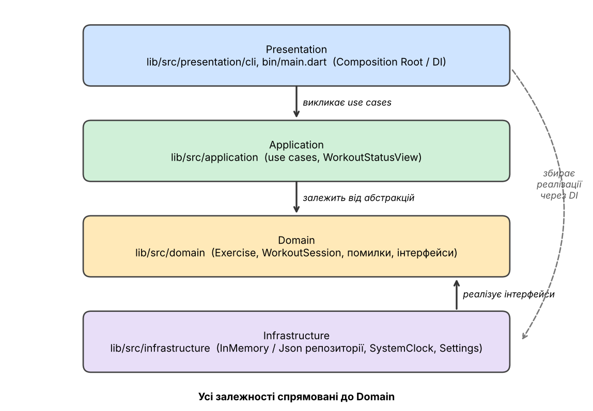
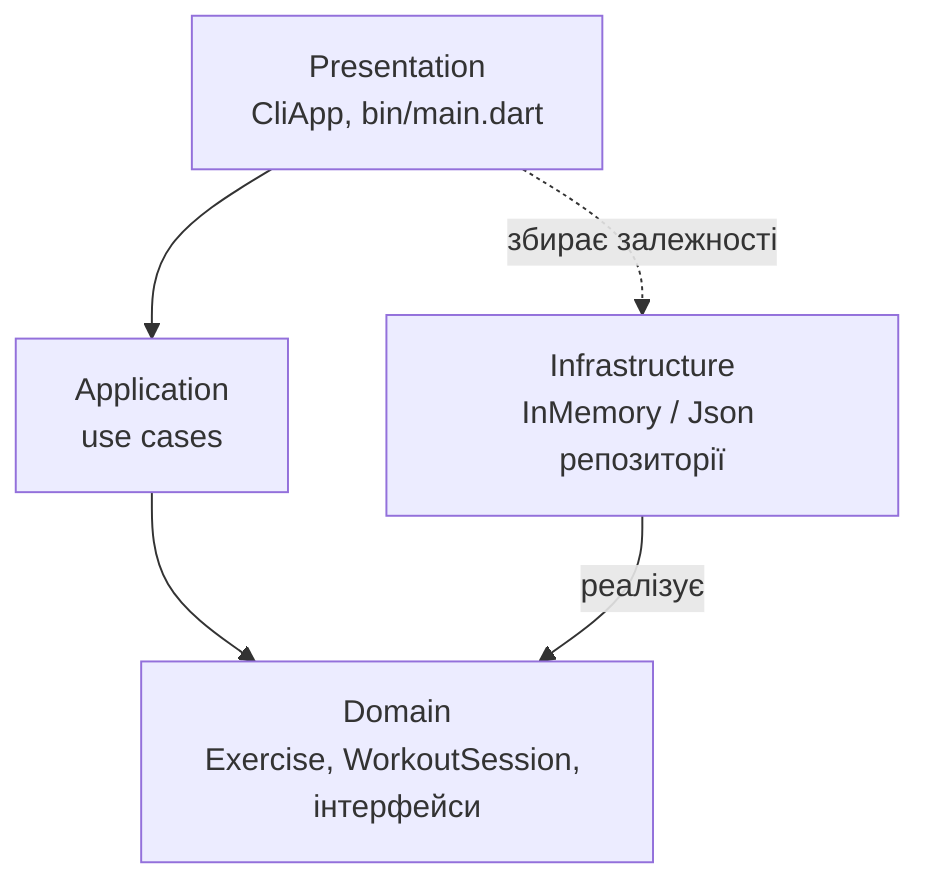

# Workout Tracker

Консольний застосунок «Трекер тренувань» на Dart зі шаруватою архітектурою (Clean Architecture).
Лабораторна робота №5: побудова архітектури застосунку та робота з Git.

## Можливості

- каталог вправ: перегляд, пошук за назвою, додавання нових;
- тренування: старт, пауза, продовження, завершення з підрахунком часу;
- додавання вправ до поточного тренування;
- статус поточного тренування та історія завершених;
- сховище налаштовується в `appsettings.json`: `memory` (у пам'яті) або `json` (файли у `storage/`).

## Архітектура





| Шар | Каталог | Відповідальність |
|---|---|---|
| Domain | `lib/src/domain` | сутності `Exercise` і `WorkoutSession`, правила станів тренування, помилки, інтерфейси `ExerciseRepository`, `WorkoutRepository`, `Clock` |
| Application | `lib/src/application` | use cases: додавання та перегляд вправ, `Start/Pause/Resume/StopWorkout`, додавання вправи до тренування, статус, історія |
| Infrastructure | `lib/src/infrastructure` | `InMemory*` і `Json*` репозиторії, `SystemClock`, `Settings`, фабрика репозиторіїв |
| Presentation | `lib/src/presentation/cli`, `bin/main.dart` | консольне меню та точка входу, що збирає залежності (DI) |

Інтерфейси репозиторіїв оголошено в Domain, а реалізації — в Infrastructure, тому Application
працює лише з абстракціями (принцип інверсії залежностей). Щоб змінити сховище, достатньо змінити
`storage` в `appsettings.json` або передати інші реалізації в `bin/main.dart`.

## Збірка і запуск

Потрібен Dart SDK 3.0 або новіший (він входить до складу Flutter).

```bash
git clone https://github.com/xxxlunti/workout-tracker-dart.git
cd workout-tracker-dart

dart pub get

dart test

dart run bin/main.dart
```

Запускати потрібно з кореня проєкту: шлях до `appsettings.json` і `storage/` рахується від поточного каталогу.
Файли даних у режимі `json` створюються автоматично в `storage/`.

## Робота з Git

- `main` — стабільний код, теги релізів (`v1.0.0`);
- `develop` — інтеграційна гілка;
- `feature/*` — гілки під конкретні задачі, зливаються в `develop` через pull request;
- повідомлення комітів за Conventional Commits (`feat`, `fix`, `refactor`, `test`, `docs`, `chore`).
